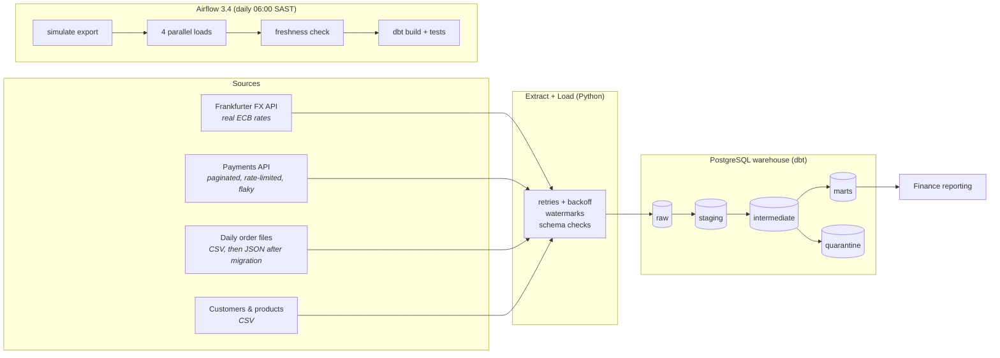
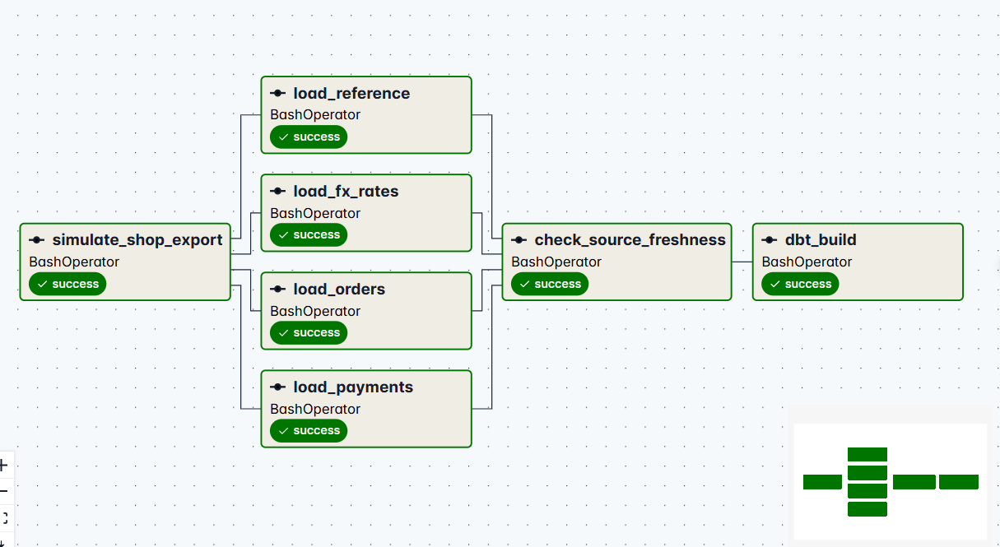
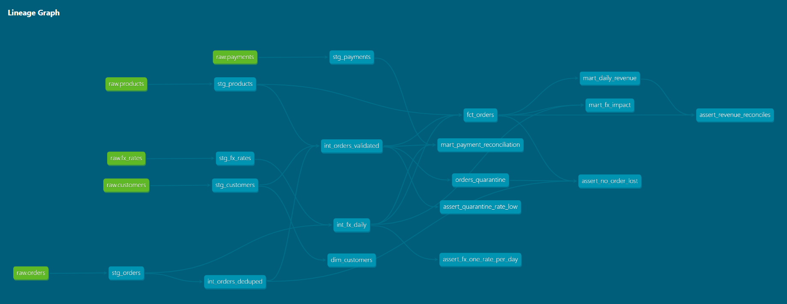

# Karoo Goods Finance Data Platform

[](https://github.com/jeadedieu/karoo-finance-data-platform/actions/workflows/ci.yml)


An end-to-end **batch ELT pipeline** for a multi-currency e-commerce business. It extracts
orders, payments and exchange rates from APIs and files, loads them into PostgreSQL
**incrementally and idempotently**, models them with **dbt** (46 data tests), and runs
every morning on **Airflow**, with the whole platform started by one `docker compose up`.

> Karoo Goods is a fictional South African online store; all data is synthetic and generated
> by the [simulator](simulator/README.md). The exchange rates are real (European Central Bank,
> via the [Frankfurter API](https://frankfurter.dev)).

---

## The business problem

Karoo Goods sells to South Africa, Europe, the UK and the US, in four currencies. Finance needs:

1. **Revenue in rand**, every morning, by day, country and product category.
2. **FX impact**: how much of foreign revenue movement came from the exchange rate, not from sales.
3. **Payment reconciliation**: which orders were never paid, double-charged or under-paid, and which payments have no order.

## Architecture



| Layer | What happens there |
|---|---|
| **raw** | Data exactly as delivered (all text) plus lineage columns `_source`, `_extracted_at`, `_loaded_at` |
| **staging** | Types, three timestamp formats, `"R1,250.00"` → `1250.00`, currency aliases, minor units → major |
| **intermediate** | Deduplication (latest version wins), validation, FX gap-filling for weekends and holidays |
| **marts** | `fct_orders`, `dim_customers`, `mart_daily_revenue`, `mart_fx_impact`, `mart_payment_reconciliation` |
| **quarantine** | Every rejected order with its reason, source file and row number |

## Results

From 13 months of data (Nov 2025 – Nov 2026):

| | |
|---|---|
| Raw order rows ingested | **123,605** from 389 daily files in two formats |
| Unique orders after deduplication | **118,287** (5,217 orders had duplicates or late updates) |
| Valid orders in `fct_orders` | **116,917** |
| Quarantined with a reason | **1,370** (1.2%): missing customer, wrong totals, invalid quantity, unknown product |
| Duplicate customer accounts merged | **85** |
| Payments reconciled | **123,199** |

**Payment reconciliation findings** (amounts in rand, approximate):

| Status | Orders | Money at stake |
|---|---:|---:|
| Unpaid orders | 1,686 | ≈ R1.6 million not collected |
| Double charges | 364 | ≈ R377k to refund customers |
| Orphan payments (no order) | 374 | ≈ R376k to investigate |
| Amount mismatches | 785 | ≈ R61k under-collected |

**Performance:** the first full load takes about 4.5 minutes (dominated by the rate-limited
payments API); daily incremental runs load each source in under 2 seconds, and `dbt build`
runs all models and 46 tests in about 10 seconds.

## Screenshots

**Airflow: the daily DAG**


**dbt lineage: from sources to marts**


## Key engineering decisions

**Reliable extraction**
- **Retry only what can succeed later.** 429, 5xx errors and timeouts are retried with exponential backoff and jitter, honouring the API's `Retry-After` header. A 401 or 400 fails immediately.
- **Two layers of retries**: seconds-level HTTP retries in the code, plus minutes-level Airflow task retries for longer outages.
- **Fail loudly on schema change.** A renamed or missing field stops the run with a message naming the field, rather than loading wrong data.

**Safe loading**: one strategy per kind of data, each idempotent (re-running changes nothing):

| Strategy | Used for | Why |
|---|---|---|
| Upsert (`INSERT … ON CONFLICT`) | payments, FX rates | Records change state later (succeeded → refunded) and have stable keys |
| Partition replace (delete + insert per file) | daily order files | Rows have no reliable key, but each file is a clean unit |
| Full refresh (`TRUNCATE` + reload) | customers, products | Small reference tables |

- **Incremental by default**: watermarks are read from the data itself (`max(updated_at)`), with a 1-hour overlap window so late updates are never missed.
- **One transaction per load**, bulk-loaded with PostgreSQL `COPY`.
- **Backfills** reprocess any date range safely: `python -m src.pipeline --orders-from 2026-03-01 --orders-to 2026-03-31`.

**Trustworthy transformations**
- **Deduplication by latest version** handles exact duplicates *and* refunds that arrive days later in another file.
- **Quarantine, never silently drop.** A test proves every order lands in exactly one place.
- **FX fill-forward**: orders on weekends and ECB holidays use the last published rate (flagged), instead of a hard-coded weekday rule.
- **Identity resolution**: customers who signed up twice are merged into one person, keeping orders from both accounts.
- **Timezones**: shop exports are local SAST time, payments are UTC; reconciliation matches on `order_id`, never on date.
- **Constant-currency FX impact**, the method finance teams use to separate currency effects from sales growth.

**Orchestration and operations**
- Each source is its **own Airflow task**, so one failing source doesn't block the others, and `dbt build` acts as a **quality gate**.
- `max_active_runs=1` prevents overlapping runs; `catchup=False` avoids surprise replays.
- The pipeline runs in a **separate virtual environment** inside the Airflow image, so dbt or pandas upgrades can never break Airflow (and vice versa).

## Testing

| Level | What | Where |
|---|---|---|
| Unit tests (12) | Retry logic, backoff, JSON/CSV parsing, schema-change detection | `tests/test_extract.py` |
| Integration tests (5) | Idempotent upserts, partition replacement, watermark overlap, against real PostgreSQL | `tests/test_load_integration.py` |
| Data tests (46) | Unique/not-null keys, accepted values, relationships, plus custom business checks: *no order lost*, *revenue report reconciles to orders*, *one FX rate per day*, *quarantine rate < 2%* | `warehouse/` |
| CI | Every push: lint → tests → end-to-end run on a month of data → dbt build | `.github/workflows/ci.yml` |

## Bugs the tests caught

Real issues found during development, and how they were fixed:

1. **Duplicate customer accounts** caused ~1,100 valid orders to be rejected → identity resolution (`canonical_customer_id`).
2. **`NaN` in JSON exports** (Python writes it, but it isn't valid JSON) became the text `"nan"` → fixed in the exporter and extractor, then **backfilled only the affected months**.
3. **A correlated subquery** made `dim_customers` take 113 s → rewritten as a `GROUP BY`: 0.2 s.
4. **Orders outside the FX calendar** during a backfill → calendar now extends to the latest order date.
5. **Windows file locking** (SQLite file renamed while still open) → connections closed explicitly; one reason the platform now runs in Docker.

## Run it yourself

**Requirements:** Docker Desktop (4 GB+ memory for Docker).

```bash
git clone https://github.com/jeadedieu/karoo-finance-data-platform.git
cd karoo-finance-data-platform
docker compose up -d --build
```

Then open **http://localhost:8080**, unpause `karoo_daily_pipeline` and click **Trigger**. The first
run generates the data and does a full load (~5 minutes).

| Service | Address |
|---|---|
| Airflow UI | http://localhost:8080 |
| Payments API docs | http://localhost:8000/docs |
| Warehouse (PostgreSQL) | `localhost:5433`, user `karoo`, password `karoo` (local development only) |

**Local development without Airflow:**
```bash
python -m venv .venv && source .venv/bin/activate     # Windows: .venv\Scripts\activate
pip install -r requirements-dev.txt
cp .env.example .env
python simulator/generate_data.py          # source data up to yesterday
python simulator/payments_api.py           # in a second terminal
python -m src.pipeline                     # extract + load
python -m src.transform build              # dbt models + tests
pytest                                     # unit tests (integration tests need DB_NAME=karoo_test)
```

## Project structure

```
├── dags/karoo_daily_pipeline.py   Airflow DAG
├── src/
│   ├── extract.py                 API clients (retries, pagination), file readers, schema checks
│   ├── load.py                    upsert / partition replace / full refresh, watermarks, COPY
│   ├── pipeline.py                CLI: incremental runs, single steps, backfills
│   ├── transform.py               runs dbt with settings from .env
│   └── config.py                  settings and logging
├── sql/001_raw_schema.sql         raw + meta schemas (schema as code)
├── warehouse/                     dbt project: staging → intermediate → marts, tests, seeds
├── simulator/                     synthetic source systems (data generator + payments API)
├── tests/                         pytest unit + integration tests
├── docker-compose.yml, Dockerfile the whole platform
└── .github/workflows/ci.yml       continuous integration
```

## Stack, and the equivalents elsewhere

| Here | Role | Common alternatives |
|---|---|---|
| Python, requests, pandas | Extract and load | Airbyte, Fivetran, Meltano |
| PostgreSQL | Warehouse | Snowflake, BigQuery, Redshift, Databricks |
| dbt Core | In-warehouse transformation and testing | SQLMesh, Dataform |
| Airflow 3 (LocalExecutor) | Orchestration | Dagster, Prefect; managed: AWS MWAA, Google Cloud Composer |
| Docker Compose | Local platform | Kubernetes (Helm) in production |
| GitHub Actions | CI | GitLab CI, Jenkins |

## What I'd add for production

- **Incremental dbt models** for `fct_orders` once volumes reach millions of rows (a full rebuild takes seconds today).
- **Alerting** to Slack or email on task failure and on dbt warnings.
- **Secrets manager** (e.g. AWS Secrets Manager) instead of `.env`, and real authentication on Airflow.
- **Data contracts** with the source teams, so schema changes are agreed instead of detected.
- A **cloud warehouse** and **CeleryExecutor or KubernetesExecutor** for scale.

---

Built by **Jean de Dieu Kwizera** · [GitHub](https://github.com/jeadedieu)
